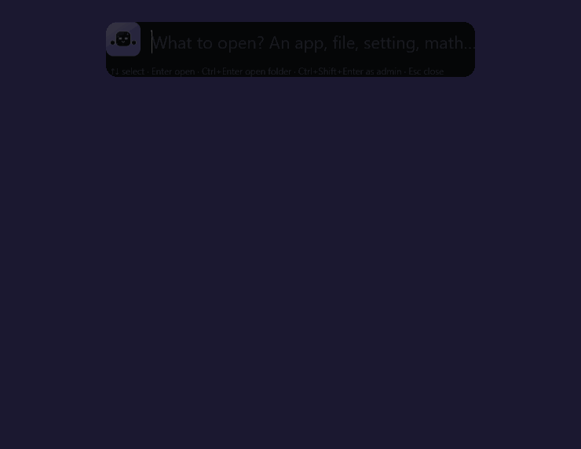
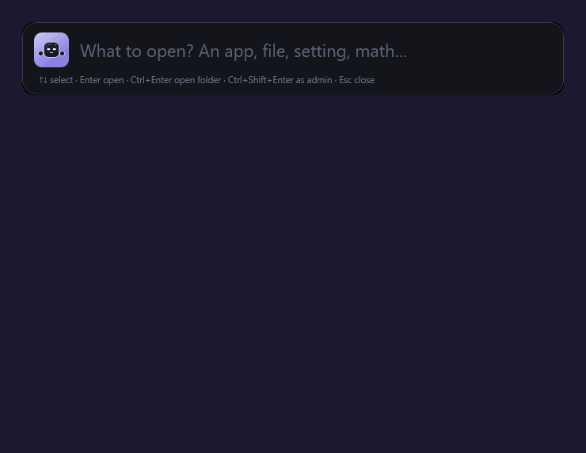
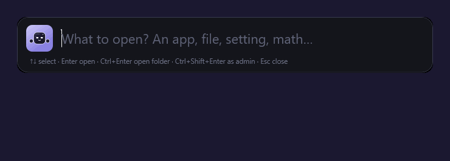
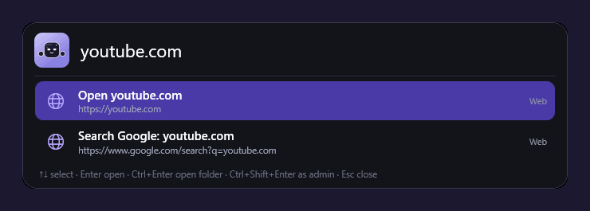

# Pitzki Launcher

<p>
  <a href="https://github.com/yahavpenso/PitzkiLauncher/releases/latest"></a>
  <a href="https://github.com/yahavpenso/PitzkiLauncher/releases"></a>
  
  
  
  
</p>

**Press Alt+Space. Type. Done.** One little box that opens anything on your PC: apps, files, folders, Windows settings, quick actions, sums and web searches. Pitzki, the night-sky cube from [Piztki](https://github.com/yahavpenso/Piztki), keeps it company.

Free. No account, no ads, no tracking. Nothing it finds ever leaves your PC.

<p align="center"></p>

<p align="center">
  <a href="https://github.com/yahavpenso/PitzkiLauncher/releases/latest"><b>⬇ Download</b></a>
  &nbsp;·&nbsp; <a href="#what-it-finds">What it finds</a>
  &nbsp;·&nbsp; <a href="#tips-and-tricks">Tips</a>
  &nbsp;·&nbsp; <a href="#keys">Keys</a>
  &nbsp;·&nbsp; <a href="#how-it-compares">Compare</a>
  &nbsp;·&nbsp; <a href="#privacy">Privacy</a>
  &nbsp;·&nbsp; <a href="#install">Install</a>
  &nbsp;·&nbsp; <a href="https://github.com/yahavpenso/PitzkiLauncher/wiki">Help pages</a>
</p>

> Every clip here is the real app, filmed by a test run. The files in them are made up for the demo, and only apps everyone has are shown.

---

## What it finds

<table>
<tr>
<td width="50%" valign="top"><b>🚀 Apps</b><br><sub>Every app on the Start menu and from the Microsoft Store, and all the Pitzki apps. Windows in another language? <code>calculator</code> still finds the Calculator app.</sub><br></td>
<td width="50%" valign="top"><b>📄 Files and folders</b><br><sub>Desktop, Documents, Downloads, Pictures, Videos and Music, plus the files you opened lately. A word from the middle of a name is enough.</sub><br></td>
</tr>
<tr>
<td width="50%" valign="top"><b>⚙️ Windows settings</b><br><sub>wifi, bluetooth, sound, display, battery, updates and more.</sub><br></td>
<td width="50%" valign="top"><b>⚡ Quick actions</b><br><sub>Lock, sleep, restart, shut down, recycle bin, task manager, screenshot. Shut down and restart ask you to press Enter twice.</sub><br></td>
</tr>
<tr>
<td width="50%" valign="top"><b>🧮 Calculator</b><br><sub>Type a sum and the answer is already there: <code>12*7+3</code>, <code>2^10</code>, <code>(5+3)/2</code>. Enter copies it.</sub><br></td>
<td width="50%" valign="top"><b>🌐 The web</b><br><sub><code>g pizza</code> searches Google, <code>yt lofi</code> searches YouTube, <code>youtube.com</code> opens the site. Anything it can't find becomes a Google search.</sub><br></td>
</tr>
<tr>
<td width="50%" valign="top"><b>⌨️ Typed with the wrong keyboard?</b><br><sub>Forgot to switch the keyboard language? It still understands what you meant and finds the right app.</sub></td>
<td width="50%" valign="top"><b>⭐ It learns</b><br><sub>What you open most, and what you opened last, moves to the top. Esc closes it, and it waits in the tray.</sub><br></td>
</tr>
</table>

## Tips and tricks

- **A few letters are enough.** `spot` → Spotify, `rome` → the Rome photos folder.
- **Ctrl+Enter** opens the folder a file is in, instead of the file.
- **Ctrl+Shift+Enter** runs an app as administrator.
- **Alt+Space taken by another program?** Right-click the tray icon, **Hotkey**, and pick Ctrl+Alt+Space, Ctrl+Shift+Space or Alt+Q.
- **Just installed something?** Tray icon → **Refresh search** and it shows up right away.
- **Click the tray icon** to open the box with the mouse.

## Keys

| Key | What it does |
|---|---|
| **Alt+Space** | Open the box (changeable) |
| **↑ ↓** | Pick a result |
| **Enter** | Open it (or copy the answer of a sum) |
| **Ctrl+Enter** | Open the folder it is in |
| **Ctrl+Shift+Enter** | Run as administrator |
| **Esc** | Close |

## How it compares

| | **Pitzki Launcher** | Windows search (Start) | PowerToys Run |
|---|---|---|---|
| Opens with one hotkey, anywhere | ✅ Alt+Space | ✅ Win | ✅ Alt+Space |
| Apps, files, settings, actions in one list | ✅ | ✅ | ✅ |
| Calculator as you type | ✅ | ✅ | ✅ |
| Typed with the wrong keyboard language | ✅ | ❌ | ❌ |
| No web results or ads mixed in unless you ask | ✅ | ❌ | ✅ |
| Learns what you open most | ✅ | Some | ✅ |
| One small download, nothing else to install | ✅ | built in | ❌ (the whole PowerToys) |
| Plugins for everything | ❌ | ❌ | ✅ (its strength) |

## Privacy

- **Everything stays on your PC.** The list of your apps and files is built in memory and never sent anywhere.
- **What you open most** is counted in `%AppData%\PitzkiLauncher\data.json`, on your PC only.
- **The internet is used only when you choose a web result** (Google, YouTube or a site), and then it simply opens your browser.
- No account, no tracking, no ads.

## Install

1. Download `PitzkiLauncher.exe` from the [Releases page](https://github.com/yahavpenso/PitzkiLauncher/releases/latest).
2. Run it. Nothing else needs to be installed: it carries everything inside.
3. Press **Alt+Space**.

It starts with Windows from then on and waits in the tray (switch that off from the tray icon, **Start with Windows**). To quit, right-click the tray icon and choose **Exit**.

**Windows may show "Windows protected your PC" the first time.** That appears for any app that isn't sold through a store or signed with a paid certificate. Choose **More info**, then **Run anyway**.

**Needs:** Windows 10 or 11, 64-bit.

## Questions

**Does it slow my PC down?** No. While the box is closed it does nothing at all (0% processor). It builds its list of apps and files in the background.

**Why doesn't it find a file?** It searches Desktop, Documents, Downloads, Pictures, Videos, Music and recent files. A file somewhere else shows up once you open it once.

**Alt+Space opens the window menu instead.** Another program took the key first. Pick a different hotkey from the tray icon.

## The Pitzki family

| | |
|---|---|
| [**Pitzki**](https://github.com/yahavpenso/Piztki) | A friendly notch at the top of your screen |
| [**Pitzki Widgets**](https://github.com/yahavpenso/PitzkiWidgets) | Little live cards on your desktop |
| **Pitzki Launcher** | This one |

Have an idea or found a bug? [Open an issue](https://github.com/yahavpenso/PitzkiLauncher/issues).

## Building from source

```
dotnet publish -c Release -r win-x64 --self-contained true -p:PublishSingleFile=true -p:IncludeAllContentForSelfExtract=true -o dist
```

`PITZKI_LAUNCHER_DEMO=<folder>` runs a demo copy next to the real one: files only from that folder, only apps everyone has, its own data, and it never touches "start with Windows". That is how the clips above were made.
